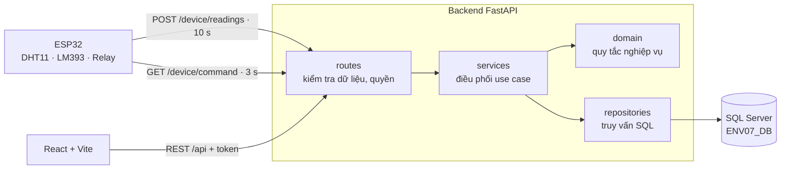
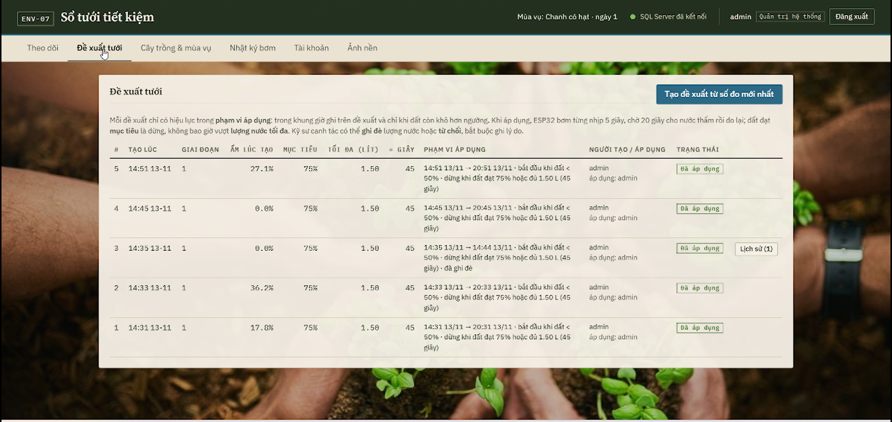
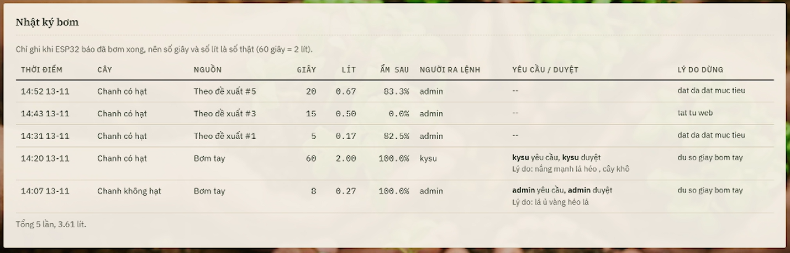
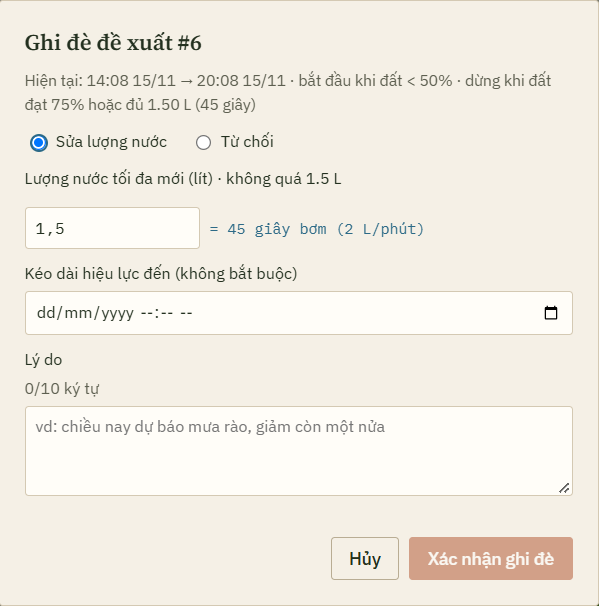
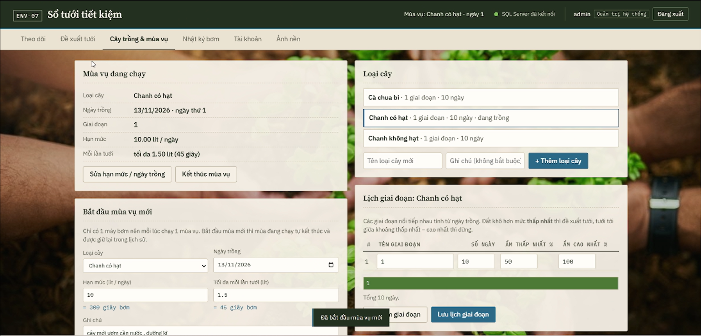
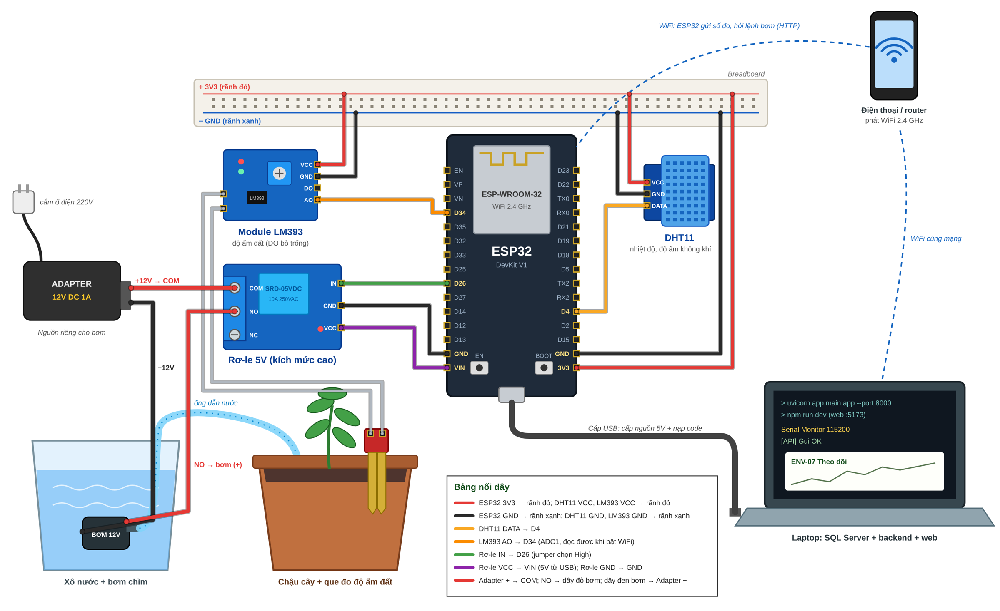

# ENV-07 · Tài liệu kỹ thuật

[▶ Video chạy thử](https://www.youtube.com/watch?v=uzhclfpjxz8&t=58s) ·
[Danh mục hình](docs/danh_muc_hinh.md) ·
[Bảng biểu](docs/bang_bieu.md) ·
[Về trang chính](../README.md)

## Mục lục

1. [Tổng quan](#tổng-quan)
2. [Kiến trúc](#kiến-trúc)
3. [Tính năng](#tính-năng)
4. [Cấu trúc thư mục](#cấu-trúc-thư-mục)
5. [Phần cứng](#phần-cứng)
6. [Cài đặt](#cài-đặt)
7. [Cấu hình](#cấu-hình)
8. [Phân quyền](#phân-quyền)
9. [API](#api)
10. [Quy tắc nghiệp vụ](#quy-tắc-nghiệp-vụ)
11. [Kiểm thử](#kiểm-thử)
12. [Tài liệu thiết kế](#tài-liệu-thiết-kế)
13. [Bảo mật](#bảo-mật)
14. [Xử lý sự cố](#xử-lý-sự-cố)

## Tổng quan

| Thành phần | Công nghệ | Vai trò |
|---|---|---|
| Thiết bị | ESP32 Dev Module, DHT11, LM393, relay 5V, bơm 12V | Đo số liệu, chạy lệnh bơm theo nhịp |
| Backend | Python 3.11+, FastAPI, Pydantic 2, pyodbc, pytest | Nghiệp vụ, phân quyền, REST API |
| Frontend | React 18.3, Vite 5.4 | Theo dõi, đề xuất, mùa vụ, tài khoản |
| Cơ sở dữ liệu | Microsoft SQL Server 2019+ | 13 bảng, 3 view, 1 thủ tục, ràng buộc CHECK |

## Kiến trúc



- **Phân tầng:** mỗi tầng chỉ gọi tầng ngay dưới nó. Toàn bộ quy tắc nghiệp vụ nằm trong `domain.py` và không phụ thuộc CSDL, nên kiểm thử đơn vị chạy được mà không cần SQL Server.
- **Thiết bị chủ động:** ESP32 tự gửi số đo và hỏi lệnh, máy chủ không cần biết địa chỉ của thiết bị.
- **Quyết định ở máy chủ:** mọi lần bơm đều do máy chủ ra lệnh để có lưu vết. ESP32 chỉ tự tắt bơm khi hết thời gian tối đa.

Sơ đồ kiến trúc chi tiết: [`docs/hinh_ve/H1_01_kien_truc_he_thong.png`](docs/hinh_ve/H1_01_kien_truc_he_thong.png)

## Tính năng

| Nhóm | Mô tả |
|---|---|
| Theo dõi | Số đo mới nhất, biểu đồ 60 lần đo, trạng thái bơm và thiết bị, hạn mức đã dùng trong ngày |
| Cây trồng và mùa vụ | Nhiều loại cây, lịch giai đoạn với vùng độ ẩm riêng, hạn mức lít mỗi ngày, giới hạn mỗi lần tưới |
| Đề xuất tưới | Tính từ số đo thật; có khung hiệu lực, ngưỡng bắt đầu, độ ẩm mục tiêu và lượng nước tối đa |
| Tưới theo nhịp | Bơm 5 giây, chờ 5 giây cho nước thấm, đo lại, dừng khi đạt mục tiêu |
| Ghi đè, từ chối | Bắt buộc lý do; lưu giá trị cũ, giá trị mới và người thao tác |
| Bơm ngoài đề xuất | Tối đa 2 lít mỗi lần, phải được duyệt |
| Tưới tự động | Bật theo mùa vụ, tự tạo và áp dụng đề xuất khi đất khô |
| Nhật ký bơm | Chỉ ghi khi ESP32 báo đã bơm xong, nên số giây và số lít là số thật |
| Tài khoản | 4 vai trò, 12 quyền, kiểm tra ở cả giao diện và API |

<table>
  <tr>
    <td width="50%"></td>
    <td width="50%"></td>
  </tr>
  <tr>
    <td align="center"><sub>Đề xuất tưới với phạm vi áp dụng và lịch sử ghi đè</sub></td>
    <td align="center"><sub>Nhật ký bơm lưu người ra lệnh, người duyệt, lý do dừng</sub></td>
  </tr>
  <tr>
    <td></td>
    <td></td>
  </tr>
  <tr>
    <td align="center"><sub>Ghi đè đề xuất có giới hạn và bắt buộc lý do</sub></td>
    <td align="center"><sub>Mùa vụ và lịch giai đoạn của cây</sub></td>
  </tr>
</table>

## Cấu trúc thư mục

```
ENV_07/
├── arduino/
│   └── arduino.ino                 Chương trình ESP32 (đo, gửi số đo, tưới theo nhịp)
├── backend/
│   ├── .env.example                Mẫu cấu hình kết nối CSDL
│   ├── requirements.txt
│   ├── app/
│   │   ├── main.py                 Khởi tạo FastAPI, CORS, xử lý lỗi
│   │   ├── routes.py               Endpoint /api, kiểm tra dữ liệu và quyền
│   │   ├── services.py             AuthService, IrrigationService
│   │   ├── domain.py               Lớp miền: Plant, Recommendation, PumpRequest, ...
│   │   ├── repositories.py         Truy vấn SQL
│   │   ├── permissions.py          Vai trò và quyền
│   │   ├── security.py             Băm mật khẩu, sinh token
│   │   ├── database.py             Kết nối, giao dịch
│   │   └── config.py               Đọc cấu hình từ .env
│   └── tests/
│       └── test_domain.py          Kiểm thử đơn vị tầng miền
├── database/
│   └── ENV07_DB/ENV07_DB.sql       Script tạo CSDL
├── frontend/
│   ├── package.json
│   ├── vite.config.js              Proxy /api sang backend
│   └── src/
│       ├── pages/                  Login, Monitor, Recommendations, CropsPlantings,
│       │                           PumpLog, Accounts, Background
│       └── components/             MoistureChart, OverrideDialog, GenerateResult, PumpRequests
└── docs/
    ├── hinh_ve/                    Sơ đồ PNG: use case, lớp, trạng thái, tuần tự,
    │                               hoạt động, thiết kế lớp, ERD, kiến trúc, nối dây
    ├── so_do_drawio/               Tệp gốc draw.io, cùng tên với tệp PNG
    ├── anh_chup/                   Ảnh chụp giao diện, linh kiện, Serial Monitor
    ├── bang_bieu.md                Toàn bộ bảng trong báo cáo
    └── danh_muc_hinh.md            Danh mục hình theo số hình trong báo cáo
```

## Phần cứng

| Linh kiện | Chân ESP32 | Ghi chú |
|---|---|---|
| DHT11 | DATA → D4 | VCC 3V3, GND chung |
| Cảm biến độ ẩm đất LM393 | AO → D34 | Dùng ADC1 vì ADC2 xung đột với WiFi; bỏ trống DO |
| Relay 5V 1 kênh | IN → D26 | Kích mức cao, VCC lấy từ VIN |
| Bơm 12V | Qua COM và NO của relay | Nguồn adapter 12V riêng, đi dây tách xa ESP32 |

Lưu lượng đo thực tế: 60 giây bơm được khoảng 2 lít. Mọi lượng nước trong hệ thống được quy đổi theo tỉ lệ này (1 lít = 30 giây).

<p align="center">
  
</p>

## Cài đặt

### Yêu cầu

| Phần mềm | Phiên bản |
|---|---|
| Microsoft SQL Server và SSMS | 2019 trở lên |
| ODBC Driver for SQL Server | 17 hoặc 18 |
| Python | 3.11 trở lên |
| Node.js | 18 trở lên |
| Arduino IDE | 2.x, đã cài board ESP32 |

### 1. Cơ sở dữ liệu

Mở SQL Server Management Studio, chạy [`database/ENV07_DB/ENV07_DB.sql`](database/ENV07_DB/ENV07_DB.sql). Script tạo mới `ENV07_DB` và không chèn dữ liệu mẫu.

### 2. Backend

```bash
cd backend
copy .env.example .env
python -m venv .venv
.venv\Scripts\activate
pip install -r requirements.txt
uvicorn app.main:app --host 0.0.0.0 --port 8000 --reload
```

Sửa `backend/.env` theo [Cấu hình](#cấu-hình). Tài liệu API tự sinh có tại http://localhost:8000/docs.

### 3. Frontend

```bash
cd frontend
npm install
npm run dev
```

Mở http://localhost:5173. Lần chạy đầu tiên, trang đăng nhập cho tạo tài khoản quản trị.

### 4. ESP32

1. Mở `arduino/arduino.ino` bằng Arduino IDE.
2. Cài **DHT sensor library** và **ArduinoJson** qua Library Manager.
3. Thay chuỗi mẫu bằng WiFi 2,4 GHz và địa chỉ IPv4 của máy chạy backend (xem bằng `ipconfig`).
4. Chọn **ESP32 Dev Module** và cổng COM, bấm Upload.
5. Mở Serial Monitor ở 115200 baud, mỗi 10 giây sẽ thấy một dòng `[DO]` và một dòng `[API] Gui OK`.

## Cấu hình

### `backend/.env`

| Biến | Ví dụ | Ý nghĩa |
|---|---|---|
| `DB_SERVER` | `localhost` | Máy chủ SQL Server |
| `DB_NAME` | `ENV07_DB` | Tên cơ sở dữ liệu |
| `DB_USER` | `sa` | Tài khoản đăng nhập |
| `DB_PASSWORD` | | Mật khẩu của máy bạn |
| `DB_DRIVER` | `ODBC Driver 17 for SQL Server` | Driver ODBC đã cài |

### `arduino/arduino.ino`

| Hằng số | Ý nghĩa |
|---|---|
| `WIFI_SSID`, `WIFI_PASSWORD` | WiFi 2,4 GHz; giữ chuỗi mẫu khi commit |
| `SERVER_URL` | `http://<IPv4 máy chạy backend>:8000` |
| `SOIL_DRY`, `SOIL_WET` | ADC khi que khô và khi nhúng nước; hiệu chỉnh cho từng que (mặc định 4095 và 1400) |

### `backend/app/config.py`

| Hằng số | Giá trị | Ý nghĩa |
|---|---|---|
| `PUMP_FLOW_LPM` | 2.0 | Lưu lượng bơm, lít mỗi phút |
| `REC_VALID_HOURS` | 6 | Thời gian hiệu lực của đề xuất |
| `MAX_PUMP_SEC` | 300 | Số giây bơm tối đa mỗi lần |
| `PULSE_SEC`, `SOAK_SEC` | 5, 5 | Nhịp bơm và thời gian chờ thấm |
| `DEVICE_OFFLINE_SEC` | 30 | Quá thời gian này coi là mất kết nối |
| `SESSION_HOURS` | 12 | Hạn của token đăng nhập |

## Phân quyền

| Quyền | Chức năng | Quản trị | Kỹ sư canh tác | Nông dân | Người xem |
|---|---|:-:|:-:|:-:|:-:|
| `view.all` | Xem số đo, đề xuất, nhật ký | ✓ | ✓ | ✓ | ✓ |
| `crop.edit` | Loại cây, lịch giai đoạn | ✓ | ✓ | | |
| `planting.edit` | Bắt đầu, sửa, kết thúc mùa vụ | ✓ | ✓ | | |
| `auto.toggle` | Bật, tắt tưới tự động | ✓ | ✓ | | |
| `rec.generate` | Tạo đề xuất | ✓ | ✓ | ✓ | |
| `rec.apply` | Áp dụng đề xuất | ✓ | ✓ | ✓ | |
| `rec.override` | Ghi đè, từ chối đề xuất | ✓ | ✓ | | |
| `pump.request` | Gửi yêu cầu bơm tay | ✓ | ✓ | ✓ | |
| `pump.approve` | Duyệt, từ chối yêu cầu bơm | ✓ | ✓ | | |
| `pump.stop` | Dừng bơm | ✓ | ✓ | ✓ | |
| `user.manage` | Quản lý tài khoản | ✓ | | | |
| `settings.edit` | Đổi ảnh nền | ✓ | | | |

## API

Mọi endpoint có tiền tố `/api`. Endpoint cần đăng nhập nhận token qua header `Authorization: Bearer <token>`.

| Nhóm | Phương thức | Đường dẫn | Quyền |
|---|---|---|---|
| Xác thực | POST | `/auth/register` · `/auth/login` · `/auth/logout` | Công khai |
| | GET | `/auth/me` · `/roles` | Đăng nhập |
| Tài khoản | GET, POST | `/users` | `user.manage` |
| | PUT, DELETE | `/users/{id}` | `user.manage` |
| | POST | `/users/{id}/activate` | `user.manage` |
| Cây trồng | GET | `/crops` | Đăng nhập |
| | POST, PUT, DELETE | `/crops`, `/crops/{id}` | `crop.edit` |
| | PUT | `/crops/{id}/stages` | `crop.edit` |
| Mùa vụ | GET | `/plant` · `/plantings` | Đăng nhập |
| | POST, PUT | `/plantings`, `/plantings/active`, `/plantings/active/finish` | `planting.edit` |
| | POST | `/plant/mode` | `auto.toggle` |
| Theo dõi | GET | `/dashboard` · `/readings` · `/events` | Đăng nhập |
| Đề xuất | GET | `/recommendations` · `/recommendations/{id}/overrides` | Đăng nhập |
| | POST | `/recommendations` | `rec.generate` |
| | POST | `/recommendations/{id}/apply` | `rec.apply` |
| | POST | `/recommendations/{id}/override` · `/recommendations/{id}/reject` | `rec.override` |
| Bơm tay | GET | `/pump-requests` | Đăng nhập |
| | POST | `/pump-requests` | `pump.request` |
| | POST | `/pump-requests/{id}/approve` · `/pump-requests/{id}/reject` | `pump.approve` |
| | POST | `/pump/stop` | `pump.stop` |
| Thiết bị | POST | `/device/readings` · `/device/pump-done` | ESP32 |
| | GET | `/device/command` | ESP32 |
| Hệ thống | GET | `/health` · `/settings/backgrounds` | Công khai |
| | PUT | `/settings/backgrounds/{scope}` | `settings.edit` |

Mã lỗi: `400` dữ liệu sai hoặc vi phạm quy tắc nghiệp vụ, `401` chưa đăng nhập, `403` không đủ quyền, `404` không tìm thấy.

## Quy tắc nghiệp vụ

| Mã | Quy tắc |
|---|---|
| BR01 | Lượng nước tính bằng lít: 60 giây bơm = 2 lít |
| BR02 | Chỉ một mùa vụ đang chạy tại một thời điểm; ngày trồng không sau hôm nay |
| BR03 | Độ ẩm của giai đoạn trong khoảng 0 đến 100%, mức thấp nhỏ hơn mức cao |
| BR04 | Hạn mức 0 đến 1000 lít mỗi ngày; mỗi lần tưới tối đa 10 lít và không vượt hạn mức ngày |
| BR05 | Đề xuất có hiệu lực 6 giờ, chỉ áp dụng khi đất còn khô hơn ngưỡng của giai đoạn |
| BR06 | Độ ẩm mục tiêu là trung bình của mức thấp và mức cao của giai đoạn |
| BR07 | Không khí ẩm từ 85% trở lên thì giảm 10% lượng nước |
| BR08 | Ghi đè, từ chối và bơm tay đều bắt buộc lý do từ 10 đến 500 ký tự |
| BR09 | Bơm ngoài đề xuất tối đa 2 lít mỗi lần và phải được duyệt |
| BR10 | Không lần bơm nào vượt hạn mức nước còn lại trong ngày |
| BR11 | Cảm biến báo số bất thường thì không tự tưới |
| BR12 | ESP32 tự tắt bơm khi hết thời gian tối đa, kể cả khi mất kết nối |
| BR13 | Tài khoản đã có thao tác trong nhật ký chỉ bị khóa, không bị xóa hẳn |

Các quy tắc được kiểm tra ở ba nơi: ô nhập trên giao diện, Pydantic và lớp miền ở backend, ràng buộc `CHECK` trong SQL Server.

## Kiểm thử

```bash
cd backend
pytest -q
```

| Loại | Số lượng | Tài liệu |
|---|---|---|
| Kiểm thử đơn vị (tầng miền) | 12 | [`backend/tests/test_domain.py`](backend/tests/test_domain.py) |
| Kiểm thử chức năng | 27 | Bảng 7.4 trong [`docs/bang_bieu.md`](docs/bang_bieu.md) |
| Kiểm thử phần cứng | 6 | Bảng 7.5 trong [`docs/bang_bieu.md`](docs/bang_bieu.md) |
| Ma trận kiểm thử theo use case | 17 use case | Bảng 7.7 trong [`docs/bang_bieu.md`](docs/bang_bieu.md) |

## Tài liệu thiết kế

| Nội dung | Vị trí |
|---|---|
| Use case tổng quát và phân rã | `docs/hinh_ve/H2_02` đến `H2_09` |
| Biểu đồ lớp phân tích và chi tiết | `docs/hinh_ve/H2_10` đến `H2_12` |
| Lược đồ CSDL (ERD) | `docs/hinh_ve/H2_13_luoc_do_csdl.png` |
| Biểu đồ trạng thái | `docs/hinh_ve/H2_14` đến `H2_17` |
| Biểu đồ tuần tự | `docs/hinh_ve/H2_18` đến `H2_25`, `H2_31` đến `H2_38` |
| Biểu đồ hoạt động | `docs/hinh_ve/H2_26` đến `H2_30`, `H2_39` đến `H2_43` |
| Thiết kế lớp theo chức năng | `docs/hinh_ve/H3_01` đến `H3_10` |
| Tệp gốc để chỉnh sửa | [`docs/so_do_drawio`](docs/so_do_drawio), mở bằng [app.diagrams.net](https://app.diagrams.net) |
| Hình tương ứng với số hình trong báo cáo | [`docs/danh_muc_hinh.md`](docs/danh_muc_hinh.md) |
| Toàn bộ bảng của báo cáo | [`docs/bang_bieu.md`](docs/bang_bieu.md) |

## Bảo mật

- Mật khẩu người dùng được băm SHA-256 với muối ngẫu nhiên 16 byte, CSDL không lưu mật khẩu gốc.
- Token đăng nhập ngẫu nhiên, hạn 12 giờ; quyền được kiểm tra ở từng endpoint, không chỉ ẩn nút trên giao diện.
- Thông tin kết nối CSDL chỉ nằm trong `backend/.env`, tệp này có trong `.gitignore`.
- Thông tin WiFi trong `arduino.ino` để chuỗi mẫu, không commit giá trị thật.
- Kênh ESP32 dùng HTTP không mã hóa, chỉ phù hợp chạy trong mạng nội bộ.

## Xử lý sự cố

| Hiện tượng | Nguyên nhân thường gặp | Cách xử lý |
|---|---|---|
| Backend báo lỗi đăng nhập SQL Server | Sai tài khoản, mật khẩu trong `.env` hoặc chưa bật SQL Server Authentication | Kiểm tra `.env`, bật chế độ đăng nhập Mixed Mode |
| Serial báo `reason 5` khi vào WiFi | Điểm phát WiFi đã đủ số thiết bị hoặc WiFi 5 GHz | Ngắt bớt thiết bị, dùng băng tần 2,4 GHz |
| Serial báo `[API] Gui loi` | Sai `SERVER_URL` hoặc tường lửa chặn cổng 8000 | Kiểm tra IPv4 bằng `ipconfig`, mở cổng 8000 |
| Độ ẩm đất luôn 0%, ADC 4095 | Que đo nằm ngoài đất hoặc dây AO lỏng | Cắm lại que, kiểm tra dây AO, GND, VCC |
| Upload báo `No serial data received` | ESP32 chưa vào chế độ nạp | Giữ nút BOOT khi Arduino IDE bắt đầu nạp |
| Bơm tự chạy khi chạm vào mạch | Dây IN của relay lỏng | Cố định relay, thay dây ngắn cắm chặt |
