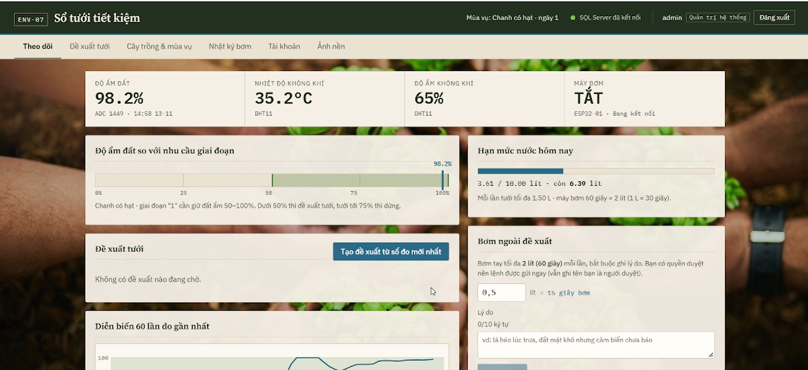

<div align="center">

# ENV-07 · Quản lý nước tưới và lịch canh tác tiết kiệm

Hệ thống IoT tưới cây theo giai đoạn sinh trưởng, tính lượng nước bằng lít và lưu vết mọi lần bơm.


[Video chạy thử](https://www.youtube.com/watch?v=uzhclfpjxz8&t=58s) · [Mã nguồn](ENV_07) · [Báo cáo và slide](Word_PPT) · [Hướng dẫn cài đặt](ENV_07/README.md)

</div>

---

## Thông tin đồ án

| | |
|---|---|
| Môn học | Phân tích và thiết kế phần mềm hướng đối tượng |
| Đơn vị | Khoa Công nghệ Thông tin, Trường Đại học Tài nguyên và Môi trường TP. Hồ Chí Minh |
| Sinh viên | Mai Tiến Đạt (1250080030), lớp K12_ĐH_CNPM1 |
| Giảng viên hướng dẫn | Th.S Phạm Trọng Huynh |

## Bài toán

Ở hộ gia đình, cây thường được tưới theo thói quen: sáng một lần, chiều một lần, tưới đến khi thấy đất ướt. Lượng nước không gắn với nhu cầu của cây ở từng giai đoạn, và không ai biết mỗi ngày đã dùng bao nhiêu nước.

ENV-07 giải quyết việc này bằng một thiết bị ESP32 đặt tại chậu cây và một ứng dụng web:

- **Đo thật:** độ ẩm đất, nhiệt độ, độ ẩm không khí được gửi lên mỗi 10 giây.
- **Đề xuất bằng lít:** hệ thống dựa vào giai đoạn sinh trưởng, hạn mức ngày và thời tiết tại chỗ để đề xuất lượng nước, kèm phạm vi áp dụng rõ ràng.
- **Có người chịu trách nhiệm:** ghi đè đề xuất phải có lý do, bơm ngoài đề xuất phải được duyệt, mọi lần bơm đều lưu người ra lệnh và số giây bơm thật.

<p align="center">
  
</p>

## Cấu trúc repo

| Thư mục | Nội dung |
|---|---|
| [`ENV_07/`](ENV_07) | Toàn bộ mã nguồn (ESP32, backend, frontend, script CSDL) và tài liệu kỹ thuật |
| [`ENV_07/docs/`](ENV_07/docs) | Sơ đồ UML, ERD, file draw.io, ảnh chụp, bảng biểu của báo cáo |
| [`Word_PPT/`](Word_PPT) | Báo cáo Word và slide thuyết trình |

## Bắt đầu nhanh

```bash
git clone https://github.com/MaiDatTien/ENV_07_DA_OOSD.git
cd ENV_07_DA_OOSD/ENV_07
```

Các bước cài cơ sở dữ liệu, backend, frontend và nạp chương trình ESP32 nằm trong [ENV_07/README.md](ENV_07/README.md).

## Tác giả

**Mai Tiến Đạt** · [@MaiDatTien](https://github.com/MaiDatTien)
